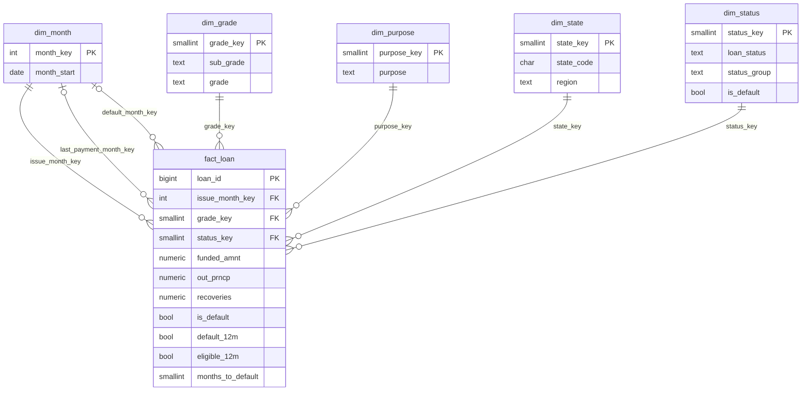

# Phase 2: PostgreSQL star schema

Database `credit_dw` (PostgreSQL 16), built by:

```powershell
uv run python -m credit_risk.warehouse.setup_db   # database, tablespace, roles, schemas (idempotent)
uv run python -m credit_risk.warehouse.load       # star schema + BI views, one transaction
uv run pytest -m db                               # checks against the loaded warehouse
```

## Model

Grain of `dw.fact_loan`: **one row per loan**, with status and amounts as of the 2019-03-31
snapshot. 2,257,919 rows, about 500 MB.



| Table | Rows | Content |
|---|---|---|
| `dw.dim_month` | 143 | Calendar months 2007-06 to 2019-04 (issue, last payment and default months) |
| `dw.dim_grade` | 35 | Sub-grades A1–G5 with grade and rank (Lending Club's own risk grade) |
| `dw.dim_purpose` | 14 | Loan purpose |
| `dw.dim_state` | 51 | US state with Census region |
| `dw.dim_status` | 7 | Snapshot status, its group, days past due, and whether it counts as default (main and strict) |
| `dw.fact_loan` | 2,257,919 | Contract, borrower at application, performance, outcome flags |

Design choices:

- **Three date roles, one month dimension:** issue month, last payment month and default
  month all point to `dim_month`.
- **Default definition lives in the data:** `dim_status.is_default` and
  `is_default_strict` are the same sets as `credit_risk.data.clean`, and a unit test fails if
  they drift apart.
- **Constraints enforce the rules:** primary and foreign keys, value ranges (FICO 300–850,
  term 36/60), and consistency checks (`months_to_default` is set exactly when the loan
  defaulted; a strict default is always a default).
- **Model features are not all here.** The warehouse holds what reporting needs. The
  scorecard reads its 70+ application features from `loans.parquet`.

## Reporting views (schema `bi`)

| View | Grain | Use |
|---|---|---|
| `bi.vintage_default_12m` | issue month × grade | 12-month default rate on loans with a complete window |
| `bi.open_book` | status × grade × term | Open loans and outstanding principal at the snapshot: the IFRS 9 book |

Open book at 2019-03-31: **912,609 loans, $9.51 bn outstanding principal**, of which
878,317 Current ($9.13 bn), 12,785 1–30 days late and 21,507 31+ days late or flagged default.

## Model results (Phase 8)

`credit_risk.warehouse.load_results` adds the model outputs, in one transaction reconciled
to the Phase 6 ECL by stage to the cent (DDL in `warehouse/sql/30_results.sql`, views in
`40_results_views.sql`). Run it after `credit_risk.warehouse.load`, because recreating
`dw.fact_loan` drops these tables' foreign keys and views.

| Table | Grain | View for Power BI |
|---|---|---|
| `dw.dim_rating` | rating R1–R10 | `bi.rating_scale` |
| `dw.fact_ecl` | open loan with principal outstanding (907,904; `bi.open_book` also counts 4,705 open-status loans with none) | `bi.ecl_loan` (with loan attributes and stage reason), `bi.ecl_by_stage` |
| `dw.fact_pd_curve` | rating × term × month on book | `bi.pd_term_structure` |
| `dw.ecl_scenario` | scenario | `bi.ecl_scenario` |
| `dw.monitoring_quarter` | issue quarter | `bi.monitoring_quarter` |
| `dw.monitoring_feature` | issue quarter × feature | `bi.monitoring_feature` |

## Load and reconciliation

The load runs as `credit_etl` in a single transaction: drop and recreate tables, COPY
dimensions and the fact in 200,000-row batches, create views, then **reconcile** total loans,
total defaults and 12-month defaults (through the view) against the Parquet file. Any
mismatch raises and rolls back, so a half-loaded or inconsistent warehouse is never
visible. Load time: about 4 minutes.

`tests/test_warehouse_db.py` also checks, as the read-only role, that the 12-month default
rate overall and for every grade equals the Phase 1 report, and that no fact row lacks a
dimension.

## Roles and security

| Role | Can do |
|---|---|
| `postgres` (superuser) | Used only by `setup_db` to create the database, tablespace and roles |
| `credit_etl` | Owns schemas `dw` and `bi`; loads data |
| `credit_ro` | `SELECT` on `dw` and `bi` only; read-only transactions by default; 120 s statement timeout. For Power BI |

`PUBLIC` has no access to the database and cannot create objects in `public`. Read-only mode
is only a default (a session can turn it off), so the test proves that `credit_ro` still
cannot delete or create anything with it turned off: the real guard is privileges.

Passwords live only in `.env` (git-ignored) and are passed to PostgreSQL as parameters,
never on a command line.

## Storage

The database lives in tablespace `credit_k` on `K:\credit-risk-data\pg_tablespace` because
the system drive is nearly full. On Windows, the folder must grant the PostgreSQL service
account (`NT AUTHORITY\NetworkService`, SID `S-1-5-20`) full control:

```powershell
icacls K:\credit-risk-data\pg_tablespace /grant "*S-1-5-20:(OI)(CI)F"
```

The write-ahead log stays in the server's data folder on `C:`; it is capped by the server's
`max_wal_size` (256 MB here).
